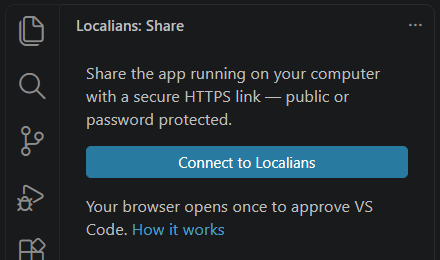
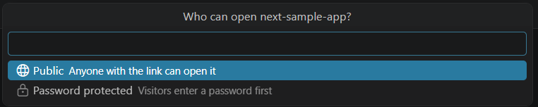
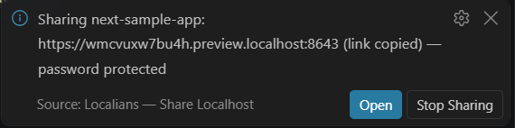
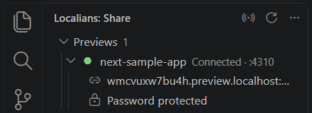

# Localians — Share Localhost

Share the app running on your computer with a secure HTTPS link — public, or protected with a password. Right from
VS Code: no terminal commands, no deploys, nothing else to install.

**Install → open your project → click Share → send the link.**

## Install

- **Marketplace:** search for **Localians** in the Extensions view (publisher: THINXIFY), or run
  `ext install thinxify.localians` in the Command Palette's quick open (`Ctrl+P` / `Cmd+P`).
- **From a file:** download `localians-<version>.vsix` from the extension's
  [releases](https://github.com/THINXIFY/Localians/releases), check it against the `.sha256` file next to it, then run
  **Extensions: Install from VSIX…** from the Command Palette and choose the file.

You need a free Localians account; the extension signs you in through your browser the first time.

## How it works

1. **Connect to Localians.** Your browser opens once so you can approve VS Code. That's the whole setup.
2. **Start your app** as usual (`npm run dev`, `python manage.py runserver`, …).
3. **Click it under _Local apps_** (or run **Localians: Share App**). Pick a project — the one that already uses that
   port is suggested, or create one named after your app — choose who can open it, and how long the link works:

   

4. **Your link is ready** and copied to the clipboard. Send it to anyone.

By default a link works until the project's free 24-hour preview (or its Preview Pass) ends; pick a shorter time to
stop it sooner. If a project's free preview is over, the extension says so and links to the dashboard, where a Preview
Pass adds more days and a custom URL. Which one applies is always decided by Localians, never by the extension.

   

Your previews stay listed in the sidebar with their status. Copy the link, open it, add a password or stop sharing
from there, the status bar, or the Command Palette.

## Finds your running apps

Localians looks for running apps on common development ports (3000, 3001, 4200, 4321, 5000, 5173, 8000, 8080, …),
plus the ports your workspace's frameworks use and any you add in **Settings → Localians → Extra Ports**. It
recognises Next.js, Vite, React, Vue, Svelte/SvelteKit, Angular, Astro, Nuxt, Remix, Django, Flask, FastAPI, Express,
NestJS, Rails and more, including apps inside monorepos (`apps/*`, `packages/*`, …).

It only ever contacts **this machine** (`127.0.0.1` / `::1`) on that short list of ports, and never shares anything
until you pick an app and confirm.

## Security and privacy

- **Nothing is public by accident.** Sharing always starts from your click; a public share asks for confirmation the
  first time for each project. Password-protected previews ask visitors for the password before they reach your app.
- **Your sign-in is a revocable token** kept in VS Code's encrypted Secret Storage — never in settings, workspace files
  or logs. Revoke it any time in the dashboard (**Settings → CLI**); sign out revokes it too.
- **Passwords** you set go straight to Localians over HTTPS (stored hashed) and are never logged. From VS Code you can
  turn password protection on or change the password; making a protected project public again is done in the
  dashboard.
- **Restricted Mode:** sharing is off until you trust the workspace, and untrusted workspaces' files aren't read.
- **Remote Development:** the extension runs where your app runs (SSH, WSL, Dev Containers, Codespaces), so
  `localhost` means the machine your dev server is on.
- **"Connected" means connected.** The status turns green only after Localians confirms the tunnel is serving.
- Closing the VS Code window stops the previews it started, so their links stop working.

## Commands

| Command | |
| --- | --- |
| **Localians: Share App** | Pick a running app and share it (also in the status bar) |
| **Localians: Stop Sharing** | Stop a preview; its link stops working immediately |
| **Localians: Copy Preview Link** / **Open Preview** | For the current preview |
| **Localians: Set Preview Password** | Protect a preview, or change its password |
| **Localians: Open Dashboard** | Projects, analytics and every preview, in the browser |
| **Localians: Connect to Localians** / **Sign Out** / **Switch Account** | Account |

## Settings

| Setting | Default | |
| --- | --- | --- |
| `localians.serverUrl` | `https://localians.com` | Only change this for a self-hosted Localians. HTTPS required (HTTP only for `localhost`). User-level only, so a workspace can't redirect your sign-in. |
| `localians.extraPorts` | `[]` | More local ports to look for apps on. |
| `localians.hostHeader` | `rewrite` | `rewrite` sends `Host: localhost:<port>` (what dev servers expect); `preserve` forwards the public host. |
| `localians.verboseLog` | `false` | Log each forwarded request (method, path, status) to **Output → Localians**. |

## Requirements

VS Code 1.90 or newer, on Windows, macOS or Linux. No Localians CLI or other install needed — the extension includes
the same tunnel client as the [`localians` CLI](https://github.com/THINXIFY/Localians/tree/main/tunnel/cli).

## Help

- [Getting started](https://localians.com/docs/getting-started) · [Troubleshooting](https://localians.com/docs/troubleshooting)
- Issues: [github.com/THINXIFY/Localians/issues](https://github.com/THINXIFY/Localians/issues)

Developed by [Thinxify Technologies](https://thinxify.com).
