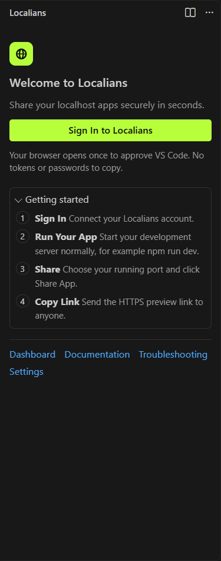
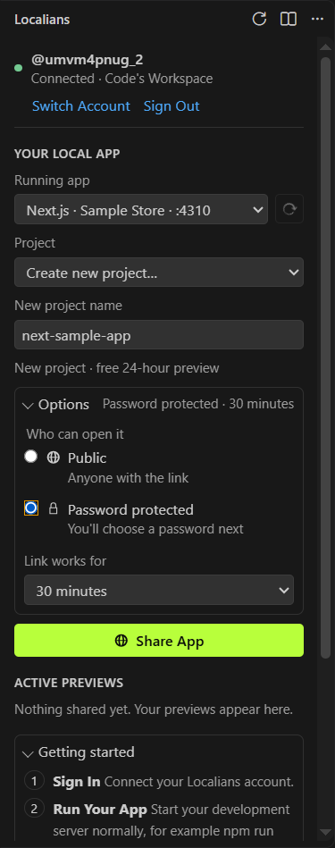
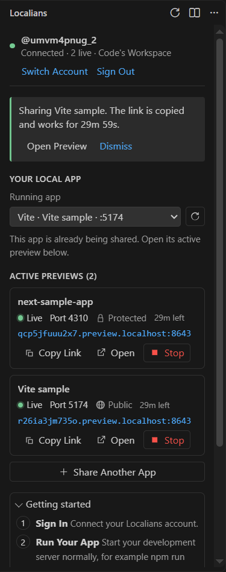
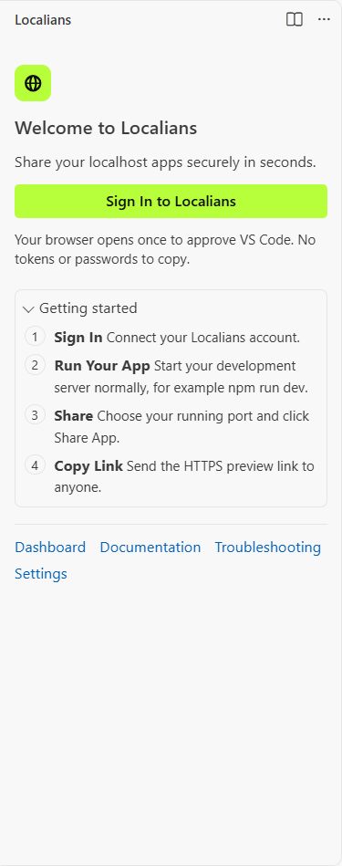

# Localians — Share Localhost

Share the app running on your computer with a secure HTTPS link — public, or protected with a password. Right from
VS Code: no terminal commands, no deploys, nothing else to install.

**Click Localians → Sign In once → pick your running app → Share App → copy the link.**

## Install

- **Marketplace:** search for **Localians** in the Extensions view (publisher: THINXIFY), or run
  `ext install thinxify.localians` in the Command Palette's quick open (`Ctrl+P` / `Cmd+P`).
- **From a file:** download `localians-<version>.vsix` from [localians.com/vscode-extension](https://localians.com/vscode-extension#download),
  check it against the SHA-256 shown there, then in the Extensions view open **… (Views and More Actions) → Install from VSIX…**
  and choose the file.

You need a free Localians account. Then click the **Localians** icon in the activity bar; **Localians: Getting Started**
walks you through the four steps.

## Sign in

Click **Sign In to Localians**. Your browser opens the approval page and the sidebar shows **Waiting for sign in…**
with a one-time code (**Copy Code** and **Open Browser Again** are there if you need them). Check that the browser shows
the same code and approve it — the sidebar updates by itself. Nothing to copy or paste.

The sidebar then shows your username and **Connected**, with **Switch Account** and **Sign Out**. The status bar shows
**Localians: Connected** (or **Localians: 2 Live** while you share); click it to open the sidebar.

## Share an app

1. **Start your app** as usual (`npm run dev`, `python manage.py runserver`, …).
2. Under **Your Local App**, pick it in **Running app** (Localians finds it), or choose **Enter a port…**.
3. Check the **Project** — the one you used for this app before, or the one that uses its port, is selected;
   otherwise a new project named after your app is suggested.
4. Optional: open **Options** to make it **Password protected** (you type the password in VS Code's own masked box) or
   to choose how long the link works.
5. Click **Share App**.

The preview appears under **Active Previews** once Localians confirms the tunnel is serving, and its link is copied
for you. By default a link works until the project's free 24-hour preview (or its Preview Pass) ends; longer lengths
are only offered with a pass. When a project's free preview is over, **Share App** becomes **Renew Preview Pass**,
which opens that project's plan page. Which plan applies is always decided by Localians, never by the extension.

## Several apps at once

Click **Share Another App** and share the next one the same way. Each preview has its own project, port, link,
timer and access, with **Copy Link**, **Open** and **Stop** — stopping one leaves the others running. Previews started
from a terminal (`npx localians share`) are listed too, and your account's limit on previews running at the same time
applies everywhere.

## Stop sharing and sign out

**Stop** ends a preview right away — its link stops working. **Sign Out** stops the previews this window started,
revokes this computer's access and forgets the token (it asks first when something is live). Closing the VS Code window
also stops the previews it started.

The sidebar follows your VS Code theme, light or dark:

## Finds your running apps

Localians looks for running apps on common development ports (3000, 3001, 4200, 4321, 5000, 5173, 8000, 8080, …),
plus the ports your workspace's frameworks use and any you add in **Settings → Localians → Extra Ports**. It
recognises Next.js, Vite, React, Vue, Svelte/SvelteKit, Angular, Astro, Nuxt, Remix, Django, Flask, FastAPI, Express,
NestJS, Rails and more, including apps inside monorepos (`apps/*`, `packages/*`, …).

It only ever contacts **this machine** (`127.0.0.1` / `::1`) on that short list of ports, and never shares anything
until you pick an app and confirm.

## Security and privacy

- **Nothing is public by accident.** Sharing always starts from your click; a public share asks for confirmation the
  first time for each project. Password-protected previews ask visitors for the password before they reach your app.
- **Your sign-in is a revocable token** kept in VS Code's encrypted Secret Storage — never in settings, workspace files
  or logs. Revoke it any time in the dashboard (**Settings → CLI**); sign out revokes it too.
- **Passwords** you set go straight to Localians over HTTPS (stored hashed) and are never logged. From VS Code you can
  turn password protection on or change the password; making a protected project public again is done in the
  dashboard.
- **Restricted Mode:** sharing is off until you trust the workspace, and untrusted workspaces' files aren't read.
- **Remote Development:** the extension runs where your app runs (SSH, WSL, Dev Containers, Codespaces), so
  `localhost` means the machine your dev server is on.
- **"Connected" means connected.** The status turns green only after Localians confirms the tunnel is serving.
- Closing the VS Code window stops the previews it started, so their links stop working.

## Commands

| Command | |
| --- | --- |
| **Localians: Open Localians** | Show the Localians sidebar (also the status bar entry) |
| **Localians: Sign In** / **Sign Out** / **Switch Account** | Your account |
| **Localians: Share App** | Share a running app step by step, without the sidebar |
| **Localians: Copy Preview Link** / **Open Preview** | For a running preview |
| **Localians: Stop Sharing** | Stop a preview; its link stops working immediately |
| **Localians: Set Preview Password** | Protect a preview, or change its password |
| **Localians: Open Dashboard** | Projects, analytics and every preview, in the browser |
| **Localians: Getting Started** | The four-step guide |

## Settings

| Setting | Default | |
| --- | --- | --- |
| `localians.serverUrl` | `https://localians.com` | Only change this for a self-hosted Localians. HTTPS required (HTTP only for `localhost`). User-level only, so a workspace can't redirect your sign-in. |
| `localians.extraPorts` | `[]` | More local ports to look for apps on. |
| `localians.hostHeader` | `rewrite` | `rewrite` sends `Host: localhost:<port>` (what dev servers expect); `preserve` forwards the public host. |
| `localians.verboseLog` | `false` | Log each forwarded request (method, path, status) to **Output → Localians**. |

## Requirements

VS Code 1.90 or newer, on Windows, macOS or Linux. No Localians CLI or other install needed — the extension includes
the same tunnel client as the [`localians` CLI](https://github.com/THINXIFY/Localians/tree/main/tunnel/cli).

## Troubleshooting

- **"No running local application found"** or **"Nothing is running on localhost:3000"** — start your dev server and
  check that the port opens in your browser, then click **Retry Detection** (or **Enter Port Manually**).
- **"This app is already being shared"** — its preview is under Active Previews; copy or stop it there.
- **"You've reached your active preview limit"** — stop another preview (here, in a terminal or in the dashboard), or
  review your plan.
- **"Connection interrupted. Reconnecting…"** — your network or computer paused; the link comes back by itself while
  VS Code and your app keep running.
- **"Your preview period has ended"** — click **Renew Preview Pass**, or choose another project.
- **"Your sign-in expired or was revoked"** — click **Sign In** again.
- Anything else: **Localians: Show Log** (tokens and passwords are never written to it), and
  [localians.com/docs/troubleshooting](https://localians.com/docs/troubleshooting).

## Help

- [VS Code guide](https://localians.com/docs/vscode) · [Getting started](https://localians.com/docs/getting-started) · [Troubleshooting](https://localians.com/docs/troubleshooting)
- Issues: [github.com/THINXIFY/Localians/issues](https://github.com/THINXIFY/Localians/issues)

Developed by [Thinxify Technologies](https://thinxify.com).
